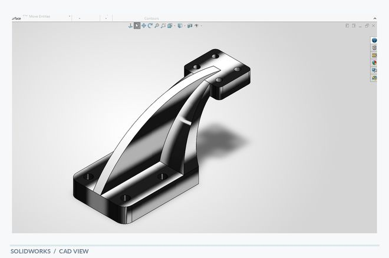
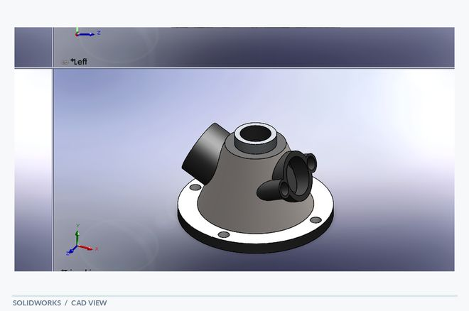
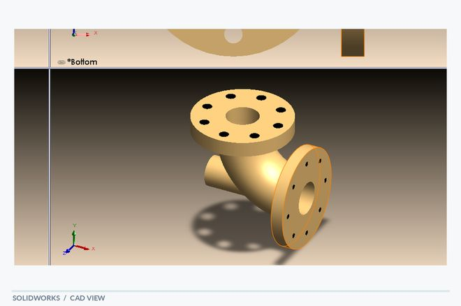
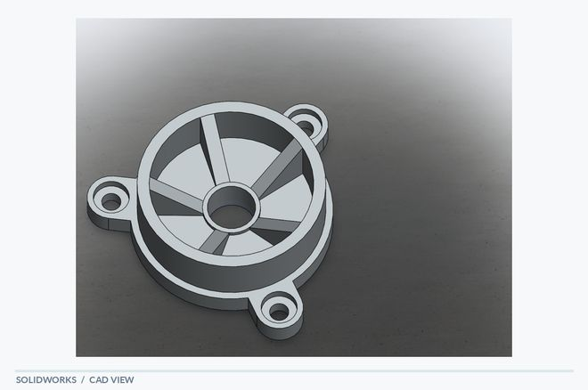
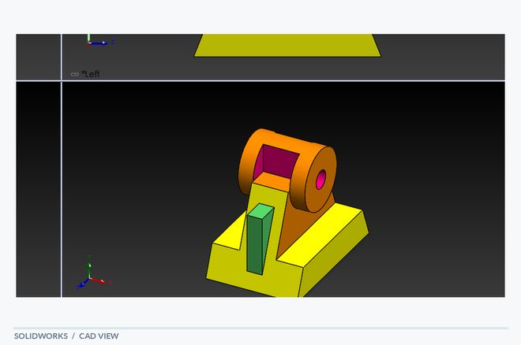
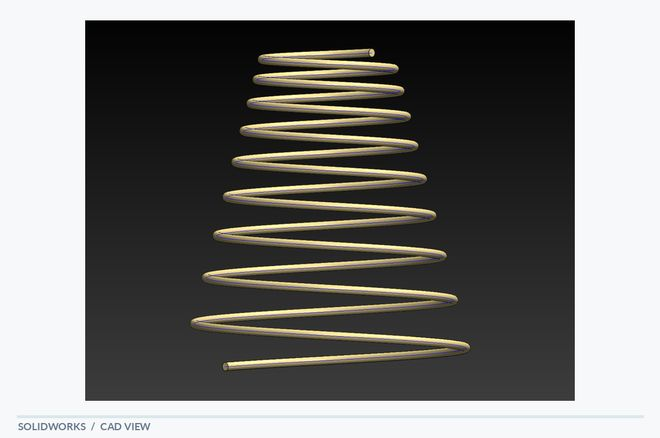
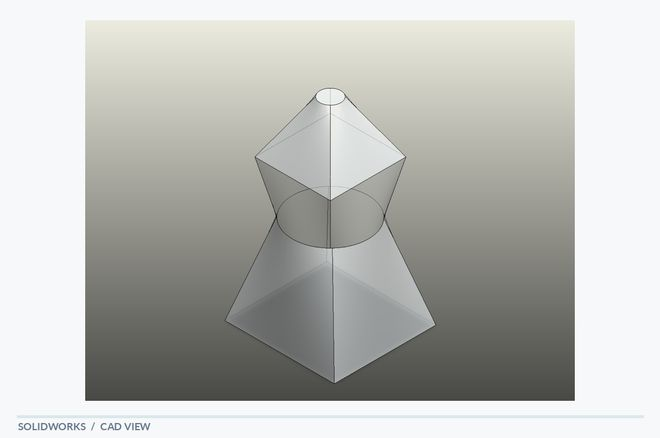
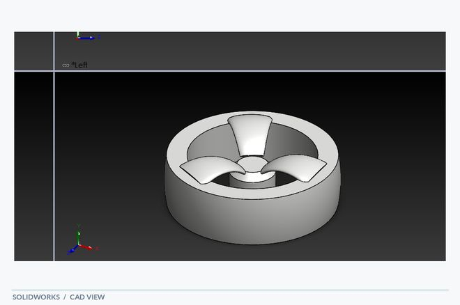
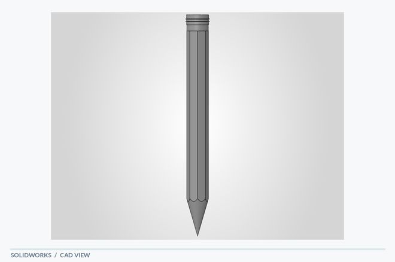

# SolidWorks | Mechanical Design Portfolio

**9 CAD modeling studies · Mechanical design · 3D geometry · Engineering documentation**

I am a student at **Technische Hochschule Deggendorf (THD)** with interdisciplinary interests in CAD design, manufacturing and programming. This portfolio presents selected SolidWorks modeling work with images, project-level notes and original PDF views. I am interested in thesis opportunities involving mechanical design, engineering development and manufacturing.

[**Explore all nine CAD studies**](projects/) · [**HR quick overview (PDF)**](HR_Quick_Overview.pdf) · [**Full visual portfolio (PDF)**](HR_Portfolio.pdf)

## Project gallery

<table>
<tr>
<td align="center"> <b><a href="projects/cantilever_bracket/">Cantilever Bracket</a></b> Reinforced support geometry</td>
<td align="center"> <b><a href="projects/multi_port_valve/">Multi-Port Valve</a></b> Angled ports and housing features</td>
<td align="center"> <b><a href="projects/pump_housing/">Pump Housing</a></b> Flanges and cylindrical intersections</td>
</tr>
<tr>
<td align="center"> <b><a href="projects/spoked_wheel_housing/">Spoked Wheel Housing</a></b> Radial layout and mounting lugs</td>
<td align="center"> <b><a href="projects/shaft_support_bracket/">Shaft Support Bracket</a></b> Support and mounting features</td>
<td align="center"> <b><a href="projects/spring/">Spring</a></b> Helical modeling</td>
</tr>
<tr>
<td align="center"> <b><a href="projects/loft/">Loft</a></b> Profile transitions</td>
<td align="center"> <b><a href="projects/wheel/">Wheel</a></b> Rim and radial geometry</td>
<td align="center"> <b><a href="projects/pencil/">Pencil</a></b> Faceted solid modeling</td>
</tr>
</table>

## Project directory (alphabetical)

| Project | Modeling focus | Documentation |
|---|---|---|
| **[Cantilever Bracket](projects/cantilever_bracket/)** | Reinforced cantilever geometry with curved support ribs and mounting interfaces. | Screenshot · PDF · project notes |
| **[Loft](projects/loft/)** | Geometric profile transitions using lofted surfaces and tapered forms. | Screenshot · PDF · project notes |
| **[Multi-Port Valve](projects/multi_port_valve/)** | Complex housing study combining angled cylindrical ports and a mounting flange. | Screenshot · PDF · project notes |
| **[Pencil](projects/pencil/)** | Faceted elongated form with a tapered tip and repeated longitudinal geometry. | Screenshot · PDF · project notes |
| **[Pump Housing](projects/pump_housing/)** | Intersecting cylindrical sections, flange details and circular mounting patterns. | Screenshot · PDF · project notes |
| **[Shaft Support Bracket](projects/shaft_support_bracket/)** | Raised cylindrical support integrated with a broader mounting base. | Screenshot · PDF · project notes |
| **[Spoked Wheel Housing](projects/spoked_wheel_housing/)** | Radially arranged spokes, a central hub and peripheral mounting lugs. | Screenshot · PDF · project notes |
| **[Spring](projects/spring/)** | Tapered helical geometry modeled as a multi-turn spring form. | Screenshot · PDF · project notes |
| **[Wheel](projects/wheel/)** | Circular rim with three shaped internal radial features. | Screenshot · PDF · project notes |

## Skills demonstrated

- **SolidWorks 3D CAD:** feature-based part modeling, mechanical form development and geometric detailing.
- **Modeling methods:** extrudes and cuts, profile transitions, circular patterns and helical forms, where shown in the projects.
- **Design communication:** organized model previews, linked PDF views and concise technical explanations.
- **Engineering interests:** CAD design, manufacturing processes and programming.

## For recruiters

For a concise visual introduction, open the **[two-page HR overview](HR_Quick_Overview.pdf)**. For more detail, open the **[full visual portfolio](HR_Portfolio.pdf)** or browse an individual project above.

> **Documentation note:** These examples illustrate SolidWorks modeling practice. The supplied PDFs are CAD views, not fully dimensioned production drawings. Materials, tolerances, performance, simulation and manufacturability have not been independently verified. The source exports include educational-use markings.

*Portfolio prepared for thesis applications in engineering and related disciplines.*
