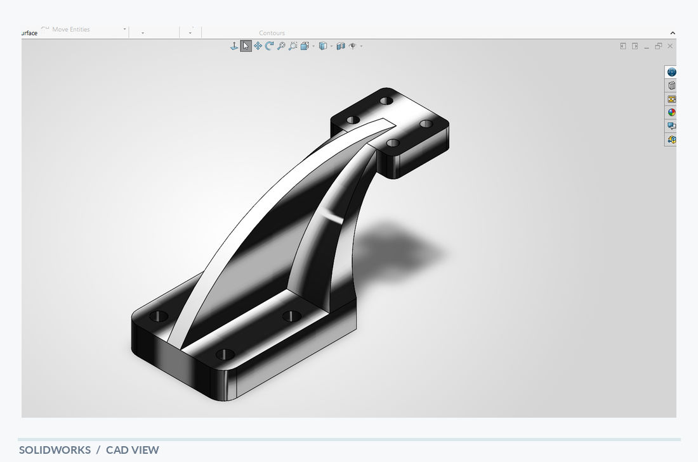

# Cantilever Bracket

[← Back to portfolio](../../README.md) · **Structural & Support Components**

## Overview

A rib-reinforced cantilever bracket with a broad base and an elevated mounting interface. The model combines a base plate, an elevated attachment point and curved reinforcing ribs. The geometry illustrates how support features can connect two mounting levels within a single part.

## Visible design features

- Base plate with mounting openings
- Elevated end mounting surface
- Curved ribs connecting the two levels

## Modeling focus

Feature-based modeling of a load-supporting bracket geometry, including fillets and integrated reinforcement.

**Keywords:** Support bracket · Rib features · Mounting interfaces

## Original design views

- [SolidWorks screenshot](cantilever_bracket.PNG)
- [PDF model view](cantilever_bracket_solidworks.pdf)

## Technical scope

A CAD study of bracket geometry and structural support features; no load capacity or stress validation is claimed.

*The notes describe geometry visible in the supplied model views; they are not a material specification, dimensional drawing or verification report.*
