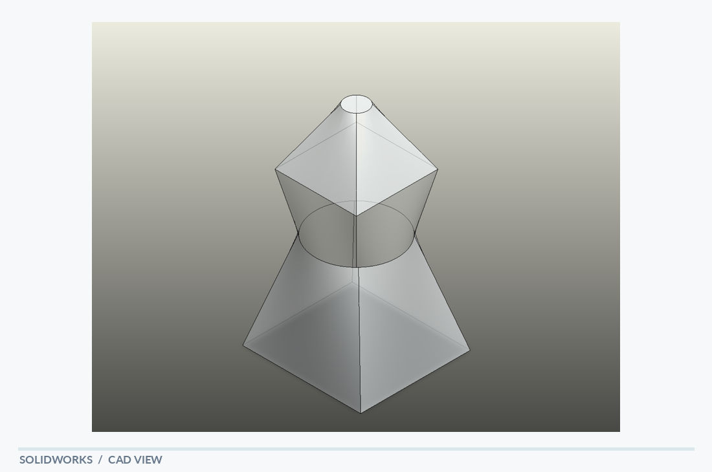

# Loft

[← Back to portfolio](../../README.md) · **Geometry & Surface Modeling**

## Overview

A symmetric loft study linking tapered polygonal sections through a cylindrical center. The solid transitions between broad faceted ends and a narrower middle section, illustrating control over profiles, proportions and smoothly connected multi-section geometry.

## Visible design features

- Tapered upper and lower profiles
- Circular central section
- Symmetrical profile transition

## Modeling focus

Geometric exploration of lofted shapes and transitions between contrasting profile types.

**Keywords:** Loft features · Profile transitions · Solid modeling

## Original design views

- [SolidWorks screenshot](Loft_solidworks.PNG)
- [PDF model view](loft_solidworks.pdf)

## Technical scope

An exploration of advanced geometric modeling, rather than a validated mechanical component.

*The notes describe geometry visible in the supplied model views; they are not a material specification, dimensional drawing or verification report.*
