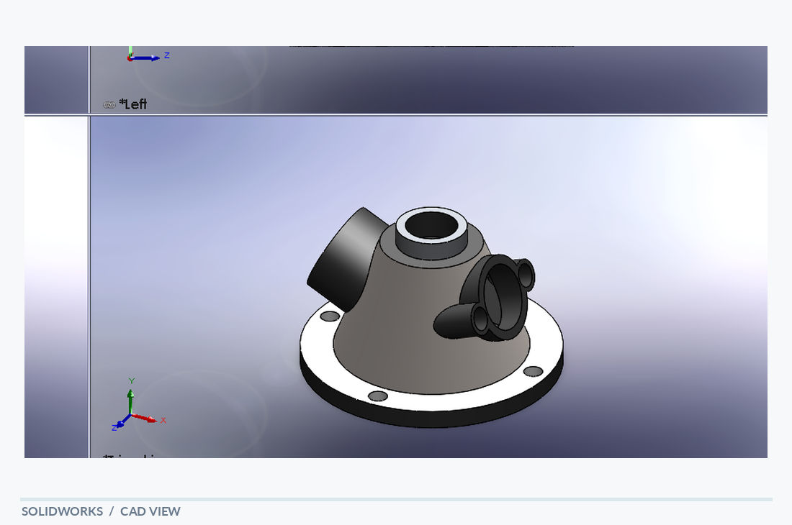

# Multi-Port Valve

[← Back to portfolio](../../README.md) · **Fluid & Housing Concepts**

## Overview

A multi-port valve body concept with a tapered main housing, inclined side connections and a mounting flange. The CAD model shows several cylindrical interfaces oriented around a central body, a top opening and a circular base with attachment features. It demonstrates the organization of intersecting features in a multi-directional housing.

## Visible design features

- Tapered central body
- Multiple angled cylindrical ports
- Central opening and circular mounting flange

## Modeling focus

Solid modeling of a complex housing with intersecting cylindrical features and arranged connection points.

**Keywords:** Multiple ports · Angled bosses · Flanged base

## Original design views

- [SolidWorks screenshot](multi_port_valve_solidworks.PNG)
- [PDF model view](multi_port_valve_solidworks.pdf)

## Technical scope

A geometry study only; no sealing, flow performance or pressure rating is documented.

*The notes describe geometry visible in the supplied model views; they are not a material specification, dimensional drawing or verification report.*
