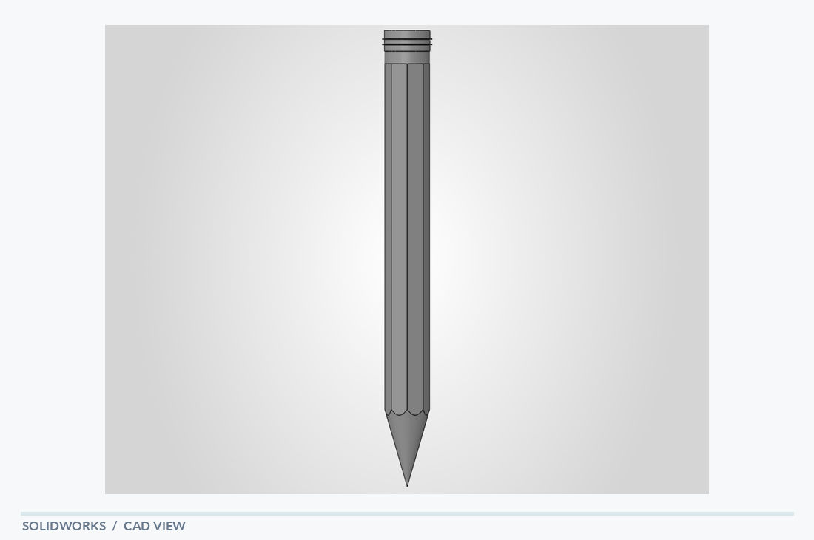

# Pencil

[← Back to portfolio](../../README.md) · **Everyday Object Modeling**

## Overview

A slender pencil model combining a faceted main body with a tapered writing tip. The model focuses on a long, slender form, distinct longitudinal faces and the transition into a pointed end. This simple object highlights attention to proportions and smaller repeated or symmetric details.

## Visible design features

- Long, prismatic body
- Tapered lower tip
- Small details at the upper end

## Modeling focus

Fundamental extrusion, cut and shape-transition modeling of a recognizable everyday object.

**Keywords:** Longitudinal features · Point geometry · Axial form

## Original design views

- [SolidWorks screenshot](pencil_solidworks.PNG)
- [PDF model view](pencil_solidworks.pdf)

## Technical scope

An object-modeling exercise; not a manufacturing specification.

*The notes describe geometry visible in the supplied model views; they are not a material specification, dimensional drawing or verification report.*
