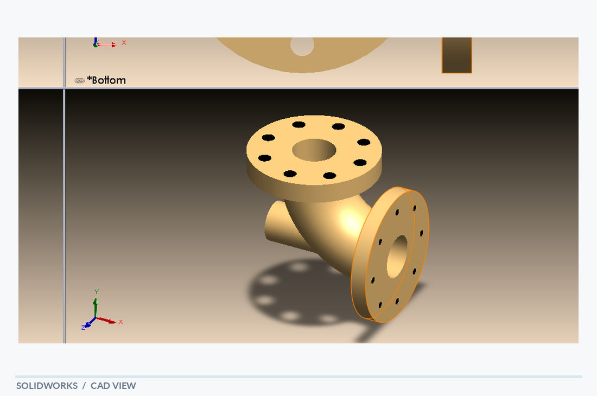

# Pump Housing

[← Back to portfolio](../../README.md) · **Fluid & Housing Concepts**

## Overview

A flanged pump-housing concept built around cylindrical passages and a side connection. The model combines a central cylindrical body, circular flange plates and a perpendicular branch. Repeated mounting holes on the flange communicate how the housing could interface with adjacent parts.

## Visible design features

- Cylindrical main housing
- Circular flange and bolt-hole pattern
- Perpendicular outlet or connection feature

## Modeling focus

Part modeling of connected tubular forms with circular interfaces and patterned fastening features.

**Keywords:** Flanges · Bolt circle · Cylindrical junctions

## Original design views

- [SolidWorks screenshot](Pump_housing.PNG)
- [PDF model view](pump_housing_solidworks.PDF)

## Technical scope

A housing form study; internal flow passages and pump function are not verified by the supplied drawings.

*The notes describe geometry visible in the supplied model views; they are not a material specification, dimensional drawing or verification report.*
