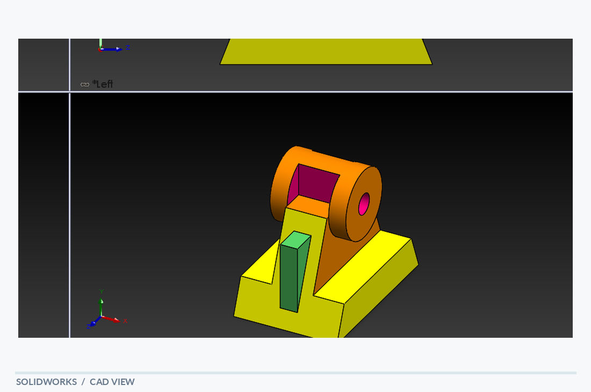

# Shaft Support Bracket

[← Back to portfolio](../../README.md) · **Structural & Support Components**

## Overview

A raised shaft-support bracket with a cylindrical upper feature and a wider base. The model uses a broad foot and vertical support features to position a hollow cylindrical interface above the mounting plane. Multiple views reveal the relationship between the upper boss, central rib and base.

## Visible design features

- Raised cylindrical support feature
- Upright central rib or web
- Broad mounting base

## Modeling focus

Geometric modeling of a supported cylindrical connection with an integrated base.

**Keywords:** Shaft support · Raised boss · Base geometry

## Original design views

- [SolidWorks screenshot](shaft_support_bracket_solidworks.PNG)
- [PDF model view](shaft_support_bracket_solidworks.PDF)

## Technical scope

A conceptual bracket model; bearing fit and shaft-load validation are not supplied.

*The notes describe geometry visible in the supplied model views; they are not a material specification, dimensional drawing or verification report.*
