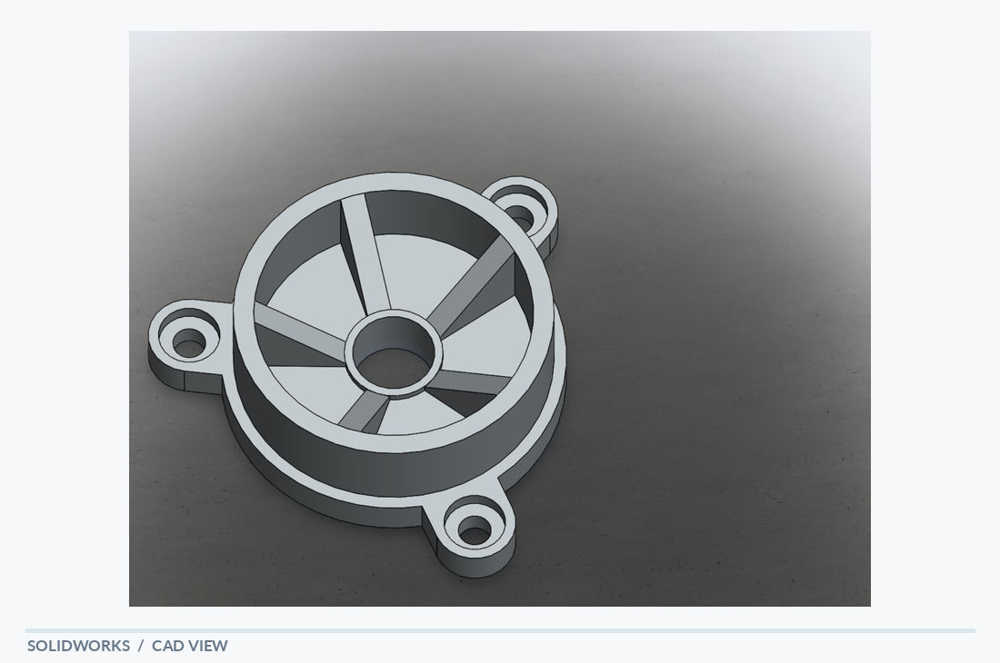

# Spoked Wheel Housing

[← Back to portfolio](../../README.md) · **Rotational & Wheel Components**

## Overview

A spoked wheel-style housing with a ring, central hub and mounting lugs. Radial spokes connect the central hub to a circular outer ring. Three protruding mounting tabs with holes extend beyond the rim, giving the model a clear connection between rotational geometry and fixed attachment points.

## Visible design features

- Radial spoke pattern and central opening
- Circular outer ring
- Three mounting lugs with through-holes

## Modeling focus

Repeated radial features, patterned geometry and part integration around a central axis.

**Keywords:** Radial spokes · Central hub · Mounting lugs

## Original design views

- [SolidWorks screenshot](spoked_wheel_housing_solidworks.PNG)
- [PDF model view](spoked_wheel_housing_solidworks.pdf)

## Technical scope

A CAD geometry concept; functional rotational behavior is not established by these images.

*The notes describe geometry visible in the supplied model views; they are not a material specification, dimensional drawing or verification report.*
