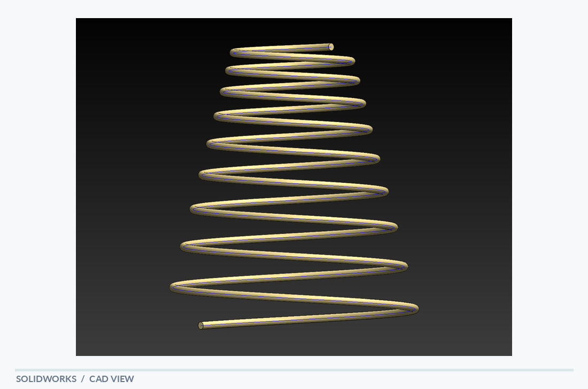

# Spring

[← Back to portfolio](../../README.md) · **Rotational & Wheel Components**

## Overview

A tapered helical spring model with a gradually varying coil diameter. The visible wire form winds through multiple turns, becoming narrower toward the top. This demonstrates control over three-dimensional swept geometry along a helical path.

## Visible design features

- Multi-turn helical path
- Larger lower and smaller upper coil diameters
- Continuous circular wire profile

## Modeling focus

Helix-driven geometry and sweep modeling for a variable-diameter spring form.

**Keywords:** Helix · Variable diameter · Swept geometry

## Original design views

- [SolidWorks screenshot](spring_solidworks.PNG)
- [PDF model view](spring_solidworks.pdf)

## Technical scope

CAD geometry only; spring rate, material choice and fatigue behavior have not been assessed.

*The notes describe geometry visible in the supplied model views; they are not a material specification, dimensional drawing or verification report.*
