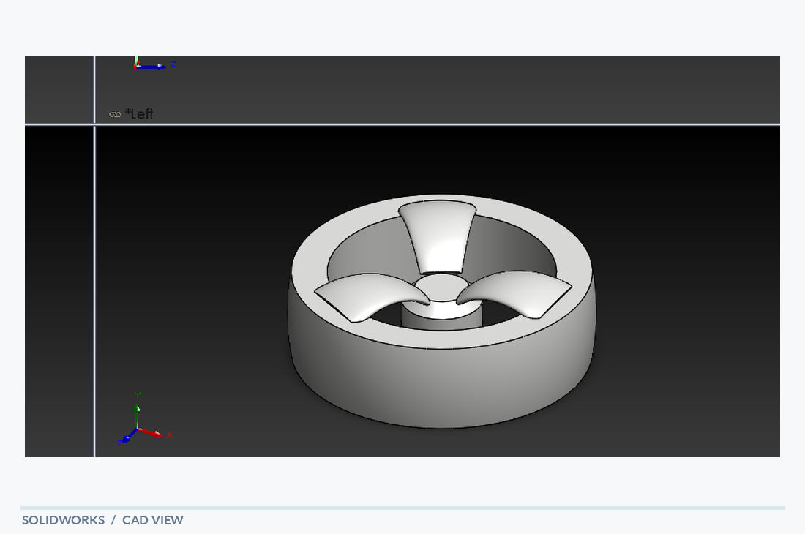

# Wheel

[← Back to portfolio](../../README.md) · **Rotational & Wheel Components**

## Overview

A wheel-like rotational component with a circular rim and three internal radial elements. The model has a recessed circular face, an outer rim and three shaped inner features arranged around the center. Several orthogonal views make the relationship between the rim and the inner geometry visible.

## Visible design features

- Cylindrical outer rim
- Three internal curved blade-like elements
- Recessed hub-area geometry

## Modeling focus

Circular and repeated-feature modeling of a compact wheel-style part.

**Keywords:** Circular rim · Internal vanes · Radial pattern

## Original design views

- [SolidWorks screenshot](wheel_solidworks.PNG)
- [PDF model view](wheel_solidworks.pdf)

## Technical scope

A visual CAD study; no wheel performance, operating speed or mechanical test results are implied.

*The notes describe geometry visible in the supplied model views; they are not a material specification, dimensional drawing or verification report.*
